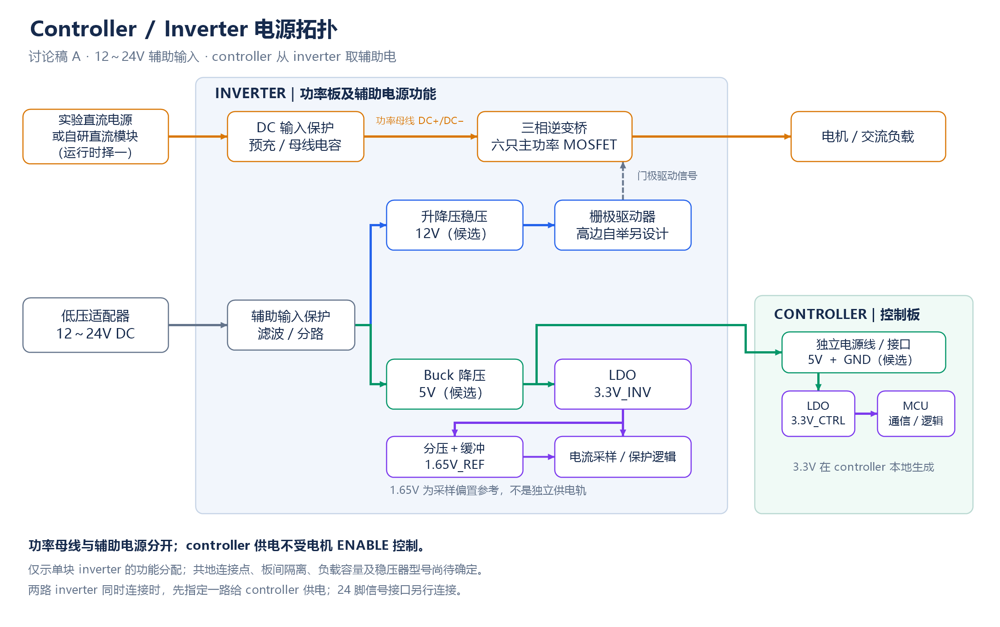
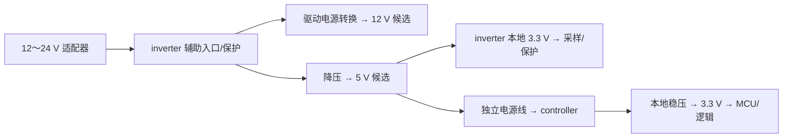

# 辅助供电、功率母线与参考地讨论记录

2026-11-05 架构变更：用户确定控制、驱动与逆变功率级合板，MCU 改为 **STM32G431**。当前依据见 [合板方案](../../docs/integrated_board.md)。本文下方 LKS、独立 controller、24 脚板间接口及旧引脚/软件预算属于上一版记录；旧 KiCad/BOM/检查结果不代表新合板版本已完成。已确定每板一颗 MCU，分变频板与电源板，取消单 MCU 同时控制两路逆变和 PFC。LLC 在电源板恢复讨论，具体配置、接口和 MCU 完整后缀待评估。

更新：2026-10-31。只规划 controller 与 inverter。

## 已确定与当前目标

- 功率母线与辅助电源分开。第一阶段外部实验直流电源供功率母线，外部低压适配器供控制板及栅极驱动的辅助电。
- inverter 的 DC+ / DC− 可来自实验电源，也可来自以后自研模块的直流输出；运行时选择一种来源，逆变器自身输入规格须匹配。
- 用户提出辅助输入按 12～24 V 直流范围规划，目标是兼容这一范围，而不只适配某个固定电压。适配器型号/容量、输入容差与浪涌、各板分配和稳压/隔离仍未冻结。驱动侧 15 V 是旧候选，不能按已定电源轨采购器件。
- MCU 使用 3.3 V 逻辑电源。本轮按 inverter 输出 5 V、controller 本地 LDO 到 3.3 V 选型；12 V 驱动采用升降压。完整型号见下方建库交接，容量、外围和热设计待复核。

## 电源拓扑图：讨论稿 A

下图按单块 inverter 画出功能分配。本轮按 12 V 驱动、5 V 板间供电与本地 LDO 结构选器件。功率母线与辅助电源分开；接地连接点、隔离、额定容量、器件和保护细节尚未冻结。图中 1.65 V 为采样偏置参考。

[矢量 SVG](../../docs/assets/power_topology_a.svg)。controller 的 5 V 电源使用独立接插件；两路 inverter 同时连接时先指定其中一路供电，24 脚信号口另接。

## Controller 从 inverter 取辅助电的讨论方向

用户提出让 controller 从 inverter 取电，该结构可行：低压适配器先接 inverter 的 12～24 V 辅助入口，inverter 分配辅助电给自身驱动/采样及 controller。controller 电源分支来自辅助输入，而不是从功率母线 DC+ / DC− 降压；功率母线未接通时仍能调试和记录状态。

优先建议由 inverter 稳出 5 V_CTRL，经独立电源线（5 V、参考地）送到 controller，再在 controller 本地生成 3.3 V。这样 controller 不必承受适配器的整个 12～24 V 范围，也不用远距离直接传送 MCU 的 3.3 V。本轮器件按此 5 V 板间接口选型。controller 的该入口不直接兼容 12～24 V；如以后改传原始辅助电压，须重新设计 controller 本地转换级。

功能分配如下；具体转换器候选见建库清单，负载预算待详细复核：

controller 的供电分支不能由电机 ENABLE、PWM 许可或功率母线建立条件开启，否则可能形成“MCU 无电无法使能、未使能无法给 MCU 上电”的循环依赖。适配器存在且供电正常时，controller 应能在功率级关闭状态下工作；掉电和 brownout 时硬件 PWM/ENABLE 仍须保持安全默认态。2026-11-01 用户已取消首版 inverter 功率母线独立预充/限浪涌和专用放电支路，此决定不取消独立辅助输入的 eFuse/稳压器保护。

两路 inverter 同时连接时，初版指定其中一路提供 controller 电源，其余功率板的电源输出不直接并到该线上。若需要自动双路供电，再设计电源选择及防反灌；controller 单独调试可从同一个电源入口接外部稳压 5 V（若最终采用该接口），不新增无管理的并联入口。电源复用和反向电流阻断的原理见 [TI 电源路径说明](https://www.ti.com/lit/ug/tidua64/tidua64.pdf)，此处未选具体器件。

辅助电源仍走独立接插件，不修改 24 脚信号口，也不占用 MCU GPIO。5 V 输出应核对 controller、编码器/SPI 外设、通信与启动负载，落实输出保护、线缆压降、滤波/去耦和时序。隔离/共地仍按下文的单板及串联系统参考域设计；从 inverter 取电不自动建立板间隔离。

## 芯片工作电源的功能路径

实验电源或自研模块的 DC+ / DC− 进入 inverter 功率桥；另一条低压适配器输出进入辅助电源电路，分别产生 controller 的 3.3 V 和所选栅极驱动所需的电压，并给采样/保护电路提供适当电源。初期无需从宽范围功率母线上取得芯片工作电源。

controller 的 3.3 V 由板上稳压电路生成，送到 MCU 各 AVDD 引脚及所需逻辑器件；模拟供电的滤波/去耦随采样电路确定。74 脚 REF、85 脚 LDO12 不是外部供电输入。本轮先用 AP63205 生成 5 V，inverter 本地 TPS7A20、controller 本地 TLV767 分别生成 3.3 V；模拟滤波和去耦仍随应用电路设计。

栅极驱动供电独立列出电压与功耗预算，不能用 MCU 的 3.3 V 逻辑电源代替。适配器可以共用来源，但分路、保护、隔离和地参考必须按实际驱动与功率拓扑设计。本轮选择 12 V 升降压候选；15 V 仅在驱动角点验证需要时重新评估。

## 12～24 V 输入与 LDO 的评估

两路供电的划分保持不变。用户提出用 LDO 生成所需电压；本轮评估不建议所有低压负载都从 12～24 V 直接线性降压。LDO 功耗近似为 (Vin−Vout)×Iout，还应加上输入电压乘静态电流，并结合环境温度、封装和 PCB 热阻核对结温。[厂家热设计说明](https://toshiba.semicon-storage.com/us/semiconductor/knowledge/e-learning/basics-of-low-dropout-ldo-regulators/chap4/chap4-2.html)

以下假设负载为 100 mA，仅用于比较，不代表 MCU 或整板实测电流：

| 转换 | LDO 近似发热 |
| --- | ---: |
| 12 V → 3.3 V | 0.87 W |
| 24 V → 3.3 V | 2.07 W |
| 5 V → 3.3 V | 0.17 W |

本轮采用 12～24 V → Buck 降压至 5 V → 各板 LDO 至 3.3 V 的结构选型，5 V 同时用于板间供电。模拟噪声与实际负载仍需核对。LDO 的纹波抑制需在实际频率、负载和压差下核对，不能代替输入滤波、去耦与布局。

驱动电源另外设计：若要求整个 12～24 V 输入范围都输出固定 15 V，低输入端需要升压能力，不能由 LDO 或纯 Buck 实现；若要求固定 12 V，12 V 输入端也必须核对稳压压差和输入容差。本轮选择 TPS55165 升降压到 12 V，低输入角点和高边自举余量仍需验证。

原候选 2ED2182S06F 的厂家标示 VCC 输入工作范围为 10～20 V，因此 24 V 不能直接作为该器件的正常驱动电源；该器件已列入首轮驱动候选，供电及自举仍需完整核对。[Infineon 产品资料](https://www.infineon.com/part/2ED2182S06F)

## 当前共地问题的边界

inverter 已有 [第一轮器件与电源轨评估](../../inverter/docs/component_selection.md)：优先研究 12 V 门极驱动与 3.3 V 采样/保护逻辑，15 V 暂不列为必需电源，5 V 可作中间轨。本轮按 12 V 驱动选定转换器候选；仍要验证 12 V 输入端的驱动稳压与高边自举余量。

对于单块逆变板，若适配器与实验直流电源的输出规格允许，且明确采用控制/采样非隔离接口，可以将适配器输出负端、controller GND 与该逆变板 DC− 设为同一参考。先确认具体电源的输出隔离、是否已连接 PE，以及外接设备带来的地连接；不能因都是直流电源就默认允许任意连接。

这里只连接输出侧的参考点，功率电流应走实验电源—母线—功率桥的专用回路，不能经过 controller 的信号地、FFC 或调试线回流。各功率板的连接点、回流与参考引出由原理图和布局设计落实，不以“共地”代替接地设计。芯片的 AGND/GND 命名也不代表已经隔离。

实验电源输出是否浮地以具体型号说明为准。例如 [Keysight E36150 用户手册的输出隔离章节](https://www.keysight.com/us/en/assets/9922-02324/user-manuals/E36150-Series-Users-Guide.pdf)允许在其限定条件下将输出端接地；该例不能替代本项目所用电源和适配器的规格核对。

普通台式示波器地、非隔离 SWD、USB 串口及电脑可能引入另一条接地路径。不能通过断开仪器保护接地来改变参考；按既定测量/隔离方案处理。接口本身无 USB 不代表调试链路没有电脑地。

## 未来串联系统须重新审查

未来的“直流源 → 逆变交流源 → 整流/PFC → 电机逆变”包含多个功率参考域。根据整流与开关拓扑，前级直流负端和 PFC 输出负端不一定是同一电位；将它们都接到 controller GND 可能旁路正常电流路径，造成异常电流甚至短路。这是本项目拓扑层面的推导，需用最终电路逐开关状态验证。

一个适配器的同一负端给所有板直接供电，或一块 controller 用非隔离接口连接各板，都可能把这些参考域间接短接。即使适配器本身与市电隔离，其同一路输出也不提供板与板之间的隔离。未来可能需要在 PWM/故障/采样和辅助供电上设置隔离，具体位置暂未确定。

因此“单块 inverter 可讨论共地”不等于“整条实验链全部 DC− 可共地”。controller 的 24 脚接口定义仅说明控制侧信号，跨域调理与隔离应在明确的边界实现。PFC 功率板不在本轮绘制范围，仍需提前保留这项系统约束。

## 下一步要确定的参数

12～24 V 目标范围的实际容差/浪涌、适配器持续/启动电流；两路 inverter 与控制器的辅助功耗；Buck/LDO 分工；驱动电压和欠压策略；controller 与功率板的隔离/共地选择；电源输入保护、掉电顺序和连接器；调试器/示波器连接方案。稳压与驱动的具体候选已经列出；上述参数决定外围、散热及是否需要调整型号。隔离电源尚未选型。

## 器件建库交接

本轮完整型号与原厂规格书见 [建库清单](../../docs/library_build_list.md)和 [CSV](../../docs/library_build_list.csv)。供电器件候选为 TPS26600PWPR、TPS55165QPWPRQ1、AP63205WU-7、TPS7A2033PDBVR、TPS2553QDBVRQ1、TLV76733DRVR、TPS3808G33DBVR。用户建立物料库；此处不表示库内符号、封装或整板额定已审核。

首轮用于设计的负载预算为：12 V 驱动 0.25 A、5 V 总负载 1 A、controller 5 V 分支 0.5 A、controller 3.3 V 负载 0.25 A、inverter 3.3 V 负载 30 mA。这些是计算起点，不是实测值或系统保证值。电感、电容、输入保护门限和热设计以最终负载复核；特别不能将 TPS55165 的 1 A 标题额定当作本项目 12 V 输出能力。
