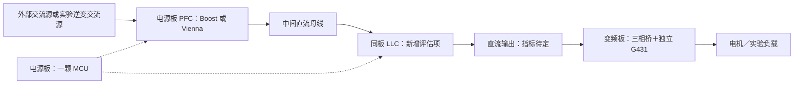

# 变频板与电源板独立控制方案

2026-11-06 最新决定：改为可拔插 G431 MCU 子板＋功率底板。以下合板 Rev C 内容作为历史草稿保留，停止继续布线，尚有 215 处待连接。新架构及接口预算见 [MCU 子板与功率底板](controller_daughterboard.md)。

更新：2026-11-06。用户已确定 **一块板一颗 MCU，分为变频板和电源板**，控制、采样保护、栅极驱动和所属功率级同板。当前先绘制变频板，暂不绘制 PFC 电源板。变频板本轮采用 **STM32G431RBT6（LQFP64）**，已建立十八页 Rev C 集成原理图审查稿；原来一颗 LKS 同时控制两路逆变和一路 PFC 的要求取消。电源板的具体 MCU 及资源另行评估。

用户随后提出在 PFC 电源板加入 LLC。本方案将 **PFC＋LLC 同板、由本板一颗 MCU 控制**纳入评估；这表示 LLC 恢复讨论，尚未冻结其功率级、指标或 G431 的完整资源分配。变频板不增加 LLC。

## 板卡分工

| 板卡 | 同板功能 | 本地控制职责 | 当前状态 |
| --- | --- | --- | --- |
| 变频板 inverter | 一套三相桥、三颗半桥驱动、采样保护、一路制动、辅助电源和一颗 STM32G431RBT6 | 三相 PWM/采样、交流源或电机控制、制动及故障管理 | 十八页 Rev C 原理图与 60×60 mm 六层 PCB0.2 布线工作稿，最终检查、额定、动态与热验证待完成 |
| 电源板 | 一个版本的 PFC 功率级、采样保护、辅助电源和一颗 MCU；正在评估同板增加 LLC | PFC 母线控制；加入 LLC 时还负责 DC/DC 调节、两级启停和故障协调 | 本阶段暂不绘图；Boost / Vienna、LLC 配置及单颗 G431 的资源可行性继续保留为后续讨论 |

“一个板一个芯片”按一颗主控 MCU 理解；栅极驱动、采样和保护芯片仍按功能选型。两个 PFC 版本分别设计，不要求把 Boost 和 Vienna 的功率电路同时装在同一块通用 PCB 上。电源板的 MCU 不依赖变频板生成 PWM 或执行本级闭环。

可使用两块相同的变频板，分别充当实验交流源和电机变频器；它们各自有 MCU。板间共同运行不再等于由一颗芯片承担所有实时控制。

该链路为加入 LLC 后的功能规划，不表示电源板输入、PFC 中间母线与 LLC 输出已经匹配；是否另设不经 LLC 的直流输出端口也未确定。变频板仍可由实验直流电源独立供电。

## 电源板两路输出

2026-11-05 用户确定电源板对外需要两路电源：一路低压辅助供电，一路功率母线。随后已确认 **功率母线为 12～60 V 可调、最大输出 10 A**。两路分别设置端口，不要求都由同一 LLC 变压器产生；辅助口的电压/电流仍待确认。

| 对外输出 | 用途 | 规格与状态 |
| --- | --- | --- |
| 辅助低压 AUX | 给变频板 MCU、采样、栅极驱动等供电，建议主功率输出关闭时仍保留启动/监控供电 | 候选固定 24 V、1 A / 24 W，未经确认；先按一块变频板预算，风扇和外设需计入总负载 |
| 功率母线 BUS | 给变频板的三相功率桥供电 | 已确认 12～60 V 可调、最大 10 A；输出能力目标按 P≤Vout×10 A，最大 600 W@60 V，连续额定及热/保护条件待校核 |

此前固定 48 V 的建议不采用为输出规格。最大 10 A 不等于所有电压下都输出 600 W：12/24/48/60 V 时，在 10 A 上限对应 120/240/480/600 W。电流限制是否可设置、恒流模式、低压大负载、动态及持续额定仍待明确。输出设到 60 V 时须处理正误差和瞬态，不能用变频板 65 V 故障门限代替 60 V 正常工作上限；后续确定最大可用设定值与输入额定裕量。

LLC 本身具备闭环调压能力：常规对称半桥以接近 50% 的互补驱动及死区工作，主要通过改变开关频率调节输出。2026-11-05 对讨论中的表述作澄清：不能从“12～60 V 是 5:1 范围”直接推出必须加 Buck；此前优先建议 Buck 过早，新增功率级仍未定稿。[ST LLC 设计指南](https://www.st.com/resource/en/application_note/an2450-llc-resonant-halfbridge-converter-design-guideline-stmicroelectronics.pdf)

先评估 **PFC → LLC → 12～60 V 母线**直接调压方案：明确 PFC 中间母线（即 LLC 输入）的标称及最小/最大电压，再计算变比、谐振参数、全负载增益范围和最高/最低频率。重点核对 60 V/10 A 的高功率点、12 V 的低增益点及轻载/空载的纹波与工作模式。目标是否能覆盖全范围须由这些计算和验证决定。[TI 宽范围 LLC 设计讨论](https://www.ti.com/document-viewer/lit/html/SSZTD86/GUID-19143819-5866-4A2A-A484-9DDA7705469C)

**PFC → LLC 隔离中间电压 → Buck → 12～60 V 母线**保留为后续备选，用于直接 LLC 在效率、调节范围或限流性能上无法满足要求的情况。若选此方案，LLC 中间输出需高于 60 V 并留足纹波、调节和压降余量，具体值仍需计算；不提前冻结或加入新图。

建议按独立启动的辅助电源支路和主功率链路分工：辅助支路先给电源板自身 MCU/驱动提供所需电源，并按隔离边界产生对外 AUX；主功率链路负责 BUS。第一阶段仍可用外部适配器代替辅助电源模块验证，不据本次输出要求自动取消此前的实验适配器。辅助源的输入取点、转换拓扑、各侧电源及最终是否集成，需在 PFC 输入/母线指标明确后确定。

同一 LLC 变压器做多个输出可行，但需处理不同负载下的交叉调整与启动偏置。主输出可调时，辅助绕组电压也可能变化，不能直接当作始终稳定的 24 V；由受控 LLC 的输出单独供其控制 MCU 还需要独立启动路径。[TI 多输出 LLC 参考](https://www.ti.com/tool/PMP40482)、[TI 宽范围 LLC 辅助偏置讨论](https://www.ti.com/document-viewer/lit/html/SSZTD86/GUID-19143819-5866-4A2A-A484-9DDA7705469C)、[ST 独立待机电源与 PFC/LLC 启动参考](https://www.st.com/resource/en/application_note/an3339-185-w-power-supply-with-pfc-and-standby-supply-for-led-tv-using-the-l6564-l6599a-and-viper27ln-stmicroelectronics.pdf)

两路对外输出不限制板内电源轨数量，也不预设其地端是否互相隔离。电源板原边 MCU/驱动供电、对外辅助输出和 LLC 次级的隔离/接地需一起核对。若候选 AUX 24 W 与 BUS 最大 600 W 同时满载，对外合计 624 W；输入预算还须加电源板自身用电及各级转换损耗，不能仍按 600 W 总输入选 PFC。若增加 Buck，LLC 的额定输出也须覆盖 600 W/Buck效率及相应瞬态，不能把 LLC 额定恰好定为 600 W 后忽略下游损耗。

每块板一颗 MCU 的要求继续保留。若增加 Buck，需要将其 PWM、采样/保护、输出侧驱动及跨隔离反馈一并纳入电源板 G431 资源评估；原 TIM1/PFC、TIM8/LLC 只是起点，不代表新增三级控制和跨域时序已经满足。

## 变频板继续沿用的要求

| 项目 | 当前要求 |
| --- | --- |
| 功率母线 | 12～60 V DC、直流输入最大 10 A；电源板输出若驱动本板须满足本板规格 |
| 单桥目标 | 每相连续 10 Arms；桥 PWM 20 kHz；额定和热设计仍待验证 |
| 辅助输入 | 独立 12～24 V，功率母线与辅助输入分开 |
| 电源轨 | 12 V 驱动、5 V 中间轨、3.3 V MCU/模拟逻辑方向；容量和分区重算 |
| 采样 | 三相电流、母线电压、三相电压和一路 NTC，共八路外部模拟信号 |
| 独立硬件保护 | 名义 ±20 A 过流、65 V 过压关断/锁存；上电/掉电默认封锁 |
| 制动 | 每块变频板一路功率支路，端子接外部电阻，由本板 MCU 控制；不用时端子开路 |
| 其他 | 普通小阻容国巨；变频板不增加 USB、霍尔、LLC 或外部 PFC 控制口 |

变频板 MCU 与本板桥之间取消 24 脚排线和独立板间 5 V 电源线。ENABLE、FAULT、BRAKE 改为板内网络，不能随连接器一起删除。本版将原 TPS2553 分支改作 +5V_SENSOR 可选传感器电源，总目标 0.5 A；J7 及外设电源连接默认 DNP，具体外设负载和上电次序仍待核。

保留旧版外部比较器、故障锁存和六路 PWM 封锁作为迁移起点，故障同时接 STM32 定时器 BKIN；内部模拟资源是否替代外部器件另审。原输入防护、热设计、采样盲区、栅压和动态响应缺口继续有效。变频板指标不能自动套给 PFC 中间母线或 LLC 的器件。

## MCU 与资源评估

变频板本轮原理图采用 **STM32G431RBT6，LQFP64，128 KB Flash、32 KB SRAM**，立创 **C431633**；该具体型号用于当前 Rev C 审查稿，额定和应用验证仍未完成。[立创商品页](https://item.szlcsc.com/428111.html)

变频板已将 TIM1 三对输出分给主桥、TIM1 BKIN 接本地 FAULT_N、TIM8 CH1 分给独立制动；八路 ADC 及其余接口已逐脚静态核对，见 [64 脚分配表](../inverter/hardware/STM32G431RBT6_pin_plan.csv)。G431 只有两个 ADC，三路电流的有效采样窗口和控制时序仍待验证；原 LKS 的 100 脚/25 路 ADC 表不再用于新版。[ST DS12589 Rev 6](https://www.st.com/resource/en/datasheet/stm32g431rb.pdf)

电源板加入 LLC 后，可评估 TIM1 用于 PFC、TIM8 用于 LLC 的分工；这只是资源分配起点，不是可行性结论。两级开关频率、LLC 变频/死区、启动、高低频限值、采样触发、同步整流和独立故障输入都需一起核对。G431 不带 HRTIM，不能把 G474 的高分辨率定时器设计原样套用。[ST RM0440 产品特性表](https://www2.st.com/resource/en/reference_manual/dm00355726-stm32g4-series-advanced-armbased-32bit-mcus-stmicroelectronics.pdf)

ST 的 STEVAL-250GANCB 采用一颗 STM32G474 控制 PFC 和半桥 LLC 原边，同步整流另用专用控制器，说明单 MCU 双级架构有实现参考；它不能证明 G431、Vienna 或本项目未定规格已经可行。当前先按用户指定 G431 评估，若资源/分辨率不满足，再讨论电源板是否更换 MCU，不自动更改选型。[ST 参考设计](https://www.st.com/en/evaluation-tools/steval-250gancb.html)

ThreadX 方向保留，各板固件分别构建、各自预算；原单颗 LKS 的线程栈、DMA 和并行控制预算不再适用。G431 的总 32 KB SRAM 包括 22 KB 常规 SRAM 和 10 KB CCM，内存及 DMA 分配后续按参考手册核对。本阶段仍以硬件为主，不展开固件实现。

## 接口与后续设计

变频板 Rev C 继续保留两路 ABZ、两路独立 SPI（SPI1/SPI3）、TTL、SWD、可选经典 CAN，以及一个电源灯和四个可编程 LED，共五灯。外部信号暂为 3.3 V 单端；CAN 分支全 DNP、HSE 可选 DNP，外设 5 V 供电连接默认 DNP，不能由 5 V 供电推断信号脚也允许 5 V。MCU 七脚 NC。具体外设、连接器、电平/ESD 防护及失电行为继续审核。

电源板独立保留自身烧录、调试及必要控制接口，具体数量按其功能确定。板间通信承载给定/状态/故障等信息，协议、物理接口、隔离和联锁线另定；原 24 脚功率控制排线不是新板间通信规范。

LLC 需要先明确半桥或全桥、输出电压/电流/功率范围、开关频率范围、整流方式及隔离反馈；PFC 需要明确先做 Boost 还是 Vienna 版本及输入/中间母线指标。两级的启动顺序、欠压/过压与负载故障协调随后设计，不能只按 PWM 数量判断芯片够用。

## 文件迁移与状态

变频板当前入口为 [十八页 Rev C KiCad 工程](../inverter/hardware/README.md)，对应 [BOM](../inverter/hardware/bom/bom.csv) 共 313 条位号/测试点记录、17 条 DNP。当前 [60×60 mm 六层 1 oz 双面 PCB0.2](../inverter/hardware/PCB_REVIEW.md)正在布线，四个 M2 孔；全部功能保留，最终连通/DRC/一致性及导出物待整合。Rev B 的逻辑检查及 PCB0.1 通过结果只覆盖当时文件，不代表本轮紧凑封装、物料、电气或热已验证。

旧 inverter 十三页分板 Rev A 已保存在 [历史归档](../inverter/history/split_rev_a_2026-11-06.zip)，controller 九页原生文件和资料继续作历史参考；旧检查结果不覆盖新稿。200×140 mm 四层 PCB0.1 已作 [改板前归档](../inverter/history/pcb_0_1_200x140_before_60mm_2026-11-06.zip)。本轮没有修改公共库；公共台账与项目实际符号/封装状态分别记录，项目 draft 不等于公共 reviewed。

controller 目录停止作为独立实体控制板推进；inverter 为当前变频合板设计入口。PFC 电源板按 2026-11-06 用户要求暂不绘制，已有 PFC/LLC 与两路输出讨论继续保留，不因本轮范围收缩更改其规格。旧库物料可按实际用途复用，新增型号仍按公共库流程维护。

本阶段继续审查变频板的电气额定、输入保护配合、采样盲区与故障时序、热设计、完整封装和可采购料号。电源板后续独立完成 PFC＋LLC 的指标与资源评估，再另行绘图；当前不将其可行性写为已验证。
