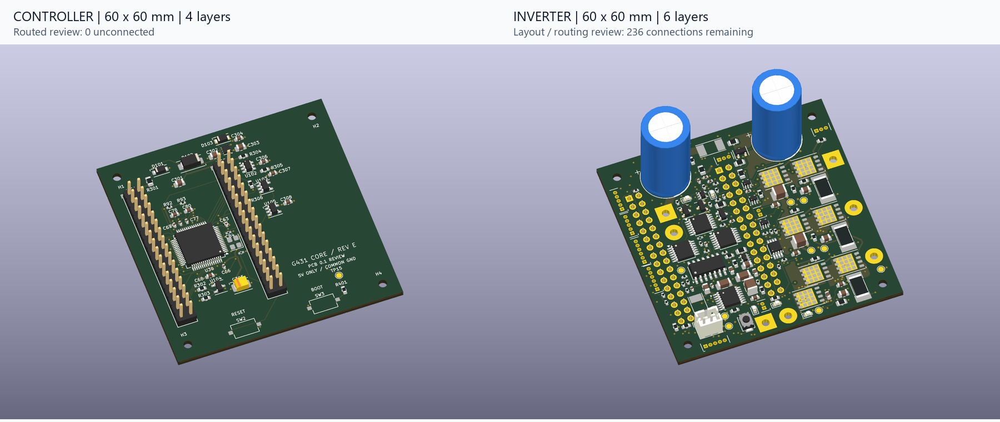

# Rev E PCB 0.1 布局审查（2026-11-11）

本轮从当前共享库版原理图新建两块60×60mm PCB，供查看结构、器件布局和布线路径。下板为MCU最小系统，上板为功率与应用电路，使用同一64针合同上下插合；本轮PCB未作为制板版本发布。

| 板卡 | 原生PCB | 层数候选 | 当前状态 |
| --- | --- | --- | --- |
| 下层controller | [controller.kicad_pcb](../controller/hardware/g431_core/controller.kicad_pcb) | 4层、1.6mm | 1041段线、95过孔，已填铜；0未连接、0电气/几何DRC错误 |
| 上层inverter | [inverter.kicad_pcb](../inverter/hardware/inverter.kicad_pcb) | 6层、1.6mm | 1852段线、295过孔，已填铜；236项未连接、0电气/几何DRC错误，尚未全布通 |

完整预览：[控制板正面](../outputs/pcb_review_2026-11-11/previews/controller_top.png)、[背面](../outputs/pcb_review_2026-11-11/previews/controller_bottom.png)、[3D](../outputs/pcb_review_2026-11-11/previews/controller_3d.png)；[功率板正面](../outputs/pcb_review_2026-11-11/previews/inverter_top.png)、[背面](../outputs/pcb_review_2026-11-11/previews/inverter_bottom.png)、[3D](../outputs/pcb_review_2026-11-11/previews/inverter_3d.png)。

## 两板结构

机器可读约束为 [pcb_stack_contract_rev_e.json](pcb_stack_contract_rev_e.json)。两板共同外框在原生坐标(100,100)～(160,160)，四个M2安装孔中心相距52×52mm，孔径2.2mm，孔位相对板角均为4mm。最小孔周铜避让半径2.8mm，本轮另增加3.0mm铺铜避让区并重填铜复核；支柱及螺钉外径还需按实际物料复核。

两组2×16/P2.54接插件集中在左侧，给功率板右侧保留三相桥、驱动及散热布局区域。同一装配坐标系下：

| 插接件 | 1脚坐标 | 2脚坐标 | 末排31/32脚Y坐标 |
| --- | --- | --- | --- |
| J101 | 104.73, 110.95 | 107.27, 110.95 | 149.05 |
| J102 | 128.73, 110.95 | 131.27, 110.95 | 149.05 |

下板公头装F.Cu、朝上，上板母座装B.Cu、朝下。同号焊盘必须逐号同心，不使用仅按角度或上下板俯视图判断的镜像方案。母座翻面后的原生角度显示不作为装配针号依据。

MCU和RESET/BOOT均在下板顶面。两键靠下边缘，上板底面在相应区域避开高件及下向连接器，留从侧面伸入后向下按的通道。孔位、排针位置及操作区域由两板共同约束。

母座8.5mm塑高、公头2.5mm塑高不是已验证的板间距；支柱长度仍需按接插件实际插入深度、板厚、相向元件及装配公差确定。共享库中的通用3D模型用于查看外观，实际塑座、插合及接触行程以厂家图和样件为准。

安装还需4套M2支柱及螺钉，其完整物料和长度尚未确定，单独于板载阻容待选表管理。控制板SW2/SW3与底板Q1～Q7的共享封装暂未配3D模型，预览中显示焊盘；实际封装、引脚和器件均已放入PCB。

## 布局重点

控制板保持MCU及就近去耦在顶面，VDDA/VREF、HSE、稳压/监控和NRST/ARM按当前电路布局。功率板将主电流路径和三相桥集中到右侧，功率件、电解及外接线区域优先在顶面，低压逻辑/采样按实际密度双面放置。

每相SOURCE先过分流器再到GND；驱动COM和栅源返回本相SOURCE，INA输入独立Kelvin引出。自举、HO/LO、栅阻及源极回流保持局部短环路。母线及相线铜不穿过MCU投影区作为布局目标；实际热和寄生耦合仍需后续验证。

底板两侧3.3V供电保持独立，核心参考只服务回传钳位/上拉及SWD参考。U1的8/17脚仍为EFUSE_RTN，不能因铺GND铜而短接。安装孔、接插件、DNP和全部364个原理图位号都纳入两板检查。

## 检查与后续

控制板已完成全部布线，详见 [本地审查](../controller/hardware/g431_core/PCB_REVIEW.md)。保留9条丝印警告（5条丝印覆盖铜、4条重叠）及15条原生`ki_fp_filters`元数据一致性警告；实际封装、位号、引脚及网络映射通过，电气/几何错误与未连接均为0。VBAT、VREF局部短线和PC13逃线已收口，供电/参考面均已实际填充保存。

两板最终记录包括实际未连接数、DRC分类、原理图一致性、64针同心、安装孔及板框检查，按本轮新PCB实际结果记录。此前Rev C集成板的DRC、布线和热结论不覆盖本版。[27页原理图源文件核对](../outputs/pcb_review_2026-11-11/schematic_source_check.json)确认本轮PCB工作没有改动原生原理图。

[最终跨板检查](../outputs/pcb_review_2026-11-11/system_check.json)确认364个位号、1202个唯一物理引脚映射、64针实际同心、板框、四孔及最小2.8mm孔周铜避让通过；courtyard重叠和出界均为0，现有3D引用路径均可解析。总体状态为`REVIEW_WITH_FINDINGS`，包含未完成的布线和下述项目。

功率板恢复母线连续后的 [主功率几何审计](../inverter/hardware/review/pcb_rev_e_2026-11-11/power_plane_restored/critical_geometry.json)确认14组连接全部通过：输入、熔断后、母线、主地、制动，以及三相PHASE/SOURCE/负端Kelvin。原锁定的277段主功率线、98个过孔保持；三相输出另有短的In2宽铜，补足背面铜区被局部驱动线分开的连接。新增布线后的Kelvin接触与地平面隔离，以 [最终Kelvin核对](../outputs/pcb_review_2026-11-11/final_kelvin_review.json)记录为准。

功率板当前保存快照为1852段线、295个过孔、12块导电铜区（含规则区的总zone数为46），已实际填铜。内部计数与原生DRC均为236项未连接；普通DRC有10条悬空铜警告（8过孔、2走线），电气/几何错误为0。原生parity有120条，全部为`ki_fp_filters`元数据警告；其它字段和网络名一致性问题已处理。当前统计见 [pcb_review.json](../inverter/hardware/review/pcb_rev_e_2026-11-11/pcb_review.json)及上述最终跨板检查，剩余连接逐项见 [连接清单](../outputs/pcb_review_2026-11-11/remaining_connections.csv)及 [按149个网络汇总](../outputs/pcb_review_2026-11-11/remaining_nets.csv)，详见 [功率板审查](../inverter/hardware/PCB_REVIEW.md)。

本轮增加普通信号布线、GND连接过孔，以及In3上X≤142.5mm低压区域的`+3V3_INV`铜区；BB_L1和VREG测试点TP2已闭合。In3母线VBUS铜区优先级为2，3.3V铜区优先级为1；另撤回4个网络的19段未锁定In3线（`+3V3_INV` 3段、`OC_HIGH_REF` 6段、`Net-(D206-K1{slash}A2)` 2段、`+5V_INV` 8段），恢复母线填铜连续。撤线留下5个额外普通过孔悬端，已纳入上述警告。仍有驱动、辅助电源、逻辑和接口接线待完成，当前不能据此制板。[power_copper.json](../inverter/hardware/review/pcb_rev_e_2026-11-11/power/power_copper.json)用于追踪锁定的关键功率铜，不包含全部普通布线和未连接清单。

32个纯阻焊辅助pad已注记为与同位铜pad同网，解决自身阻焊桥误判；铜几何和电路网络未改变，见 [阻焊注记独立核对](../outputs/pcb_review_2026-11-11/mask_only_net_association_review.json)。

上板按键预留区仍有薄型阻容、驱动芯片和焊线孔的二维投影，不能据此推定实际操作净空；J5线从顶面引出，避免向下进入两键操作区。实际插合后需核对两键组合操作、支柱、焊点及线束。

仍有 [65组、233个位号](parts_to_complete_2026-11-11/selection_pending.csv)待确定完整采购型号，当前按已指定封装布局；后续完整料号若改变封装或有效参数，需要同步PCB。12～60V / 输入最大10A / 每相10Arms为设计目标，电流截面、铜厚、热、保护动态与插合尚待闭环。

原理图交接及验证见 [2026-11-11记录](schematic_update_2026-11-11.md)。
