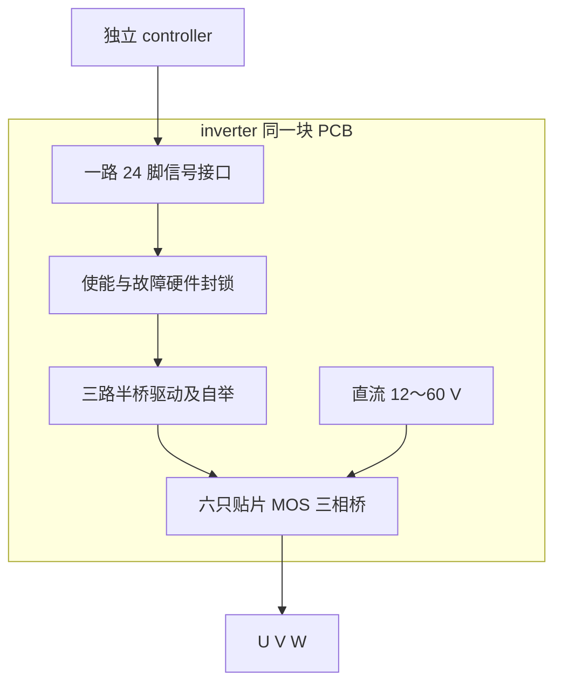

# 功率板电路

2026-11-06 Rev D：当前已改为G431可插拔子板与功率底板，8页+16页原理图完成，新PCB尚未设计。当前入口见[分板设计](../../docs/controller_daughterboard.md)，实际参数与位号以两板当前原生图/BOM为准。**本文件下方为历次设计推导，包含已废止的合板、LKS与24针叙述。**

2026-11-06：以下为历史讨论/选型背景。当前以 [Rev C / PCB0.2 紧凑方案](PCB_REVIEW.md) 为准：60×60 mm、六层1 oz、双面装配和四个M2孔，正在布线；当前MOS为BSC110N15NS5、D1为MBRD20150CT-13。下文旧IRFS/TO-263、四层及分板叙述不构成当前装配或布局依据。

2026-11-05 架构变更：用户确定控制、驱动与逆变功率级合板，MCU 改为 **STM32G431**。当前依据见 [合板方案](../../docs/integrated_board.md)。本文下方 LKS、独立 controller、24 脚板间接口及旧引脚/软件预算属于上一版记录；旧 KiCad/BOM/检查结果不代表新合板版本已完成。已确定每板一颗 MCU，分变频板与电源板，取消单 MCU 同时控制两路逆变和 PFC。LLC 在电源板恢复讨论，具体配置、接口和 MCU 完整后缀待评估。

2026-11-01 更新：已建立 [十三页 KiCad 草稿](README.md)。**当前实际电路以 [Rev A 审查记录](design_review.md)、原生原理图和实际位号 BOM 为准**；下文保留早期讨论，不是装配依据。当前直接 U/V/W 输出，LC 未装入；自举为 2.2 uF +100 nF；故障逻辑为五颗 74LVC08A、一颗 74LVC00A 和一颗 74LVC74A，不能按旧候选数量下单。

当前第一版直流母线已确定为 12～60 V，直流母线输入电流最大 10 A；输入功率上限随母线为 120～600 W，输出相电流已定每相连续 10 A_rms，正弦峰值约 14.1 A；过载条件与额定输出功率待确定。本文其余无源件、分压和保护阈值仍含历史计算候选，必须按新范围重算；旧 100 V / 1 kW 不是当前指标。当前采用自研 LKS32MC451VCT8 controller，每块 inverter 通过一路 24 脚接口连接；原两根 20 脚线与现成评估板方案作废。三颗半桥驱动、自举及栅极电阻均集成在 inverter 同一块 PCB 上。供电来源与定稿缺口以 [交接记录](../../docs/schematic_handoff.md)及 [供电讨论](../../controller/docs/power_architecture.md)为准。

最新有源器件与电源选择见 [首轮选型评估](../docs/component_selection.md)：优先候选为 IRFS4227TRLPBF、2ED2182S06FXUMA1、INA241A1IDDFR、TLV9001IDCKR、TLV3202AIDGK、74LVC08APW,118 与 74LVC74AD,118。驱动先研究 12 V、模拟/数字逻辑 3.3 V；下文未修订的 15 V 值仅为旧候选。TLV3202 为推挽输出，故障汇总必须重做，不能沿用开漏线与接法。

栅极驱动与功率管在 inverter 板内直接连接，驱动器、自举电容、栅极电阻应靠近对应桥臂。controller 与每块 inverter 的 PWM/采样使用一路 24 脚短排线，长度暂按不超过约 15 cm；排线不传母线或栅极驱动电源。板间连接断开及上电期间均须保持功率管默认关断。

## 工作点

三相桥 PWM 开关频率已确定为 **20 kHz**，周期 **50 µs**。死区与最小有效脉宽仍需结合驱动、自举和采样窗口设计；PFC 与制动 PWM 频率另定。

直流母线工作范围为 **12～60 V**，**直流母线输入电流最大 10 A**。输入功率上限为 V_dc×10 A：12 V 时 120 W、60 V 时 600 W；交流侧有功输出还需扣除损耗。输出相电流按每相连续 10 A_rms 设计，正弦峰值约 14.1 A，另计 PWM 纹波；相电流硬件过流名义门限已定瞬时 ±20 A；短时过载和总关断延迟另行核对。输入电流与相电流限值需同时满足，不能按全输出电压与 10 A 相电流必然可同时实现来标功率。

理想 SVPWM 线性区里，线电压有效值最大约为 \(V_{dc}/\sqrt{2}\)。

| 母线 | 理想线性区最大线电压有效值 |
| --- | --- |
| 12 V | 约 8.5 V |
| 24 V | 约 17.0 V |
| 48 V | 约 33.9 V |
| 60 V | 约 42.4 V |

实际值还受死区、压降和控制裕量限制。旧 60 V_rms 输出、75 V 欠压、130 V 过压及 ±25 A 过流阈值不再作为当前定稿值。下文涉及旧母线的数字仅为历史算例；功率无源件、制动与采样刻度需在逐项讨论后更新。

## 直流输入和母线

2026-11-01 用户明确以 ATK-PD6010B V1.0 作为 inverter 的主要硬件参考，按其功能块和回路结构展开，对已定器件、供电、保护门限和接口逐项适配。母线电解已确定首版暂用两只 220 µF / 100 V 并联；参考关系与差异见 [绘图任务书](../../docs/schematic_agent_task.md#指定参考板)。

2026-11-01 用户确定首版参照 ATK：**功率母线不设置独立预充/限浪涌电路，也不设置专用母线放电支路**。原 47 Ω 预充电阻、旁路继电器及其驱动撤出首版原理图和 BOM，不增加相应控制信号。功率入口经最终选定的输入防护直接连接母线电容与三相桥；防反接、TVS 和熔断器等输入防护细节仍需单独确定。本次仅针对功率母线，独立辅助输入的 eFuse/转换器保护按已有方案继续设计；制动 MOS 与外接电阻接口保留，不能默认其自动承担断电放电。

| 元件 | 取值 | 说明 |
|------|------|------|
| 熔断器 | 15 A | 放在 DC+ |
| 母线电解电容 | **2×220 µF / 100 V 并联，总 440 µF** | 用户确定首版暂用配置；选 NCC EKYB101ELL221MK25S / C1585673；库定义、纹波与温升验证待完成 |
| 母线高频旁路 | **2×2.2 µF / 100 V，X7R，1210 贴片** | 已定国巨 CS1210KKX7R0BB225 / C5578983；靠近功率桥，偏压有效容量/纹波与布局待核，替代旧 3×250 V 薄膜候选 |
| TVS / 吸收 | 待重新选型 | 旧 5.0SMDJ150A 的工作电压不能当钳位电压；需与 200 V MOSFET 裕量校核 |

按当前首版 440 µF 配置，60 V 时电解储能约 0.792 J，65 V 时约 0.930 J。首版没有专用限浪涌或自动放电能力；上电电流/瞬态取决于实际电源、接线和输入回路，应在联调中核对，不能将电源的 10 A 设定当成所有瞬时电流的保证上限。断电后残压需实测确认，不承诺自动降至某电压的时间。100 V 是电解电容额定电压，不是允许的母线工作电压。

首版按断电接线、接好后启用实验电源输出进行联调，不把本设计视为具备带电插拔管理。PFC 接口的预充资源属于后续 PFC 规划，不因本次 inverter 决定而改动。

### 母线电解电容选型方法（2026-11-01）

本板由实验直流源或自研直流模块供电，容量需结合源阻抗/线缆、三相 PWM 电流、负载阶跃和回馈确定。母线输入最大 10 A 不是电容的纹波电流额定，不能仅按“功率对应多少 µF”选型。100 V 等级已确认，其余项目按下表核算。

| 项目 | 核算方法 |
| --- | --- |
| 容量 | 对电容净电流积分求电压波动；短时间近似恒定电流缺口时，C_eff ≥ ΔI×Δt/ΔV。实际电源/线缆及负载工况需确定，且计入容量负公差、温度和老化 |
| 纹波电流 | 求 i_C=i_source−i_bridge 在实际工况下的有效值及频谱；覆盖调制度、功率因数、输出电流、输出滤波及不平衡/动态工况。按厂家频率/温度系数核对各频率损耗，不直接套输入 10 A 或单一 100 kHz 额定 |
| ESR/ESL | 用各频段 I_rms²×ESR 估算热损耗，同时考虑电流阶跃产生的 ESR 压降与布线/器件寄生电感；不能只看低频容值 |
| 寿命/温度 | 优先研究 105°C、高纹波及较长耐久寿命系列；根据实际环境温度、纹波发热及厂家寿命模型评估，不把“105°C”当作寿命保证 |
| 并联数量 | 按有效容量与总纹波能力同时选择，并核对器件容差/温升/阻抗及布局导致的不均流；同型号且对称连接时才可近似相加额定，不假定完全均分 |
| 本地高频回路 | 大电解承担储能和相应频段纹波，桥臂附近另设薄膜/陶瓷等就近去耦；通过实际阻抗与布局核对电流分配、过冲和振铃，不将远处大电解替代本地去耦 |

容量算例：假设供电暂时少供 10 A，持续 100 µs，允许理想电容部分下降 0.5 V，则所需有效容量为 2000 µF。100 µs 与 0.5 V 均是说明方法的假设，尚未作为本项目供电响应或纹波指标；该算例未包含 ESR/ESL。若标称 2000 µF 器件为 −20% 容量角点，其有效容量 1600 µF 在同一假设下压降约 0.625 V，应额外计入裕量。

2026-11-01 用户已确定首版暂用 ATK 同量级的 2×220 µF / 100 V，共 440 µF；具体选型为 NCC EKYB101ELL221MK25S。前述 2000 µF 仅说明计算方法，不作为当前容量要求。440 µF 是当前原理图配置，不等于已验证全部额定工况；后续需按实际电容纹波电流、温升、母线波动和供电条件验证，必要调整时记录依据。

容量与功率相关，但固定功率并不能独立确定容量。需要确定母线电压、允许波动、净充放电功率及持续时间：若近似恒定功率缺口，可用 C_eff ≥ 2×ΔP×Δt/(V_high²−V_low²) 估算；小压差时约为 ΔP×Δt/(V_dc×ΔV)。还要核对 PWM 纹波、电源/线缆阻抗和电容纹波电流/温升。上述项目作为当前 440 µF 首版配置的验证内容，上电瞬态、回馈储能和电源稳定性同步复核；首版不增加预充或专用放电支路。

依据：[Nippon Chemi-Con 纹波发热、频率折算与寿命说明](https://www.chemi-con.co.jp/en/faq/detail.php?id=alLifetime)、[KEMET DC-Link 与高纹波应用说明](https://www.kemet.com/en/us/technical-resources/radial-crown-smd-aluminum-electrolytic-solution-for-dc-link-and-emc-applications-for-automotive-power.html)。具体采购型号仍统一在立创国内站核实，当前尚未选定型号。

### 制动斩波与外接电阻（2026-11-01 已确认）

每块 inverter 集成一路制动 MOS 及其驱动电路；两块 inverter 合计两路，分别由 controller 的 BRAKE_1、BRAKE_2 经独立低压控制接口控制。制动功率不经过 controller，也不经过 24 脚信号排线。

每块板设置一个 **2P 外接制动电阻功率端子**，两脚定义为 `BR+` 与 `BR_SW`：`BR+` 接 DC+，`BR_SW` 接制动 MOS 漏极，MOS 源极接 DC−。外接电阻跨接 BR+ 与 BR_SW，构成 `DC+ → 外接制动电阻 → 制动 MOS → DC−`。BR_SW 为开关节点，不能作为 DC− 使用。接插件型号、额定电压/电流、线径和板上布线按电阻电流与脉冲能量选择。

不需要制动耗能时，电阻可以不接，端子保持开路，**禁止用短接线替代电阻**。不接电阻意味着该支路不能吸收再生能量，不能将其视为具备制动耗能能力；实验配置应记录电阻是否安装，并按实际电源吸收能力、负载回馈和母线电压限制测试。65 V 过压关断不代替能量处理。

制动 MOS 仍以 IRFS4227TRLPBF 为候选；2026-11-01 用户已确认每块 inverter 用一颗 **TI UCC27517DBVR（SOT-23-5，立创 C99395）** 作低侧驱动，接已有稳压 12 V。控制侧 BRAKE 为 3.3 V 高有效、默认下拉关闭；驱动 IN+ 接 BRAKE，IN− 接低，OUT 经栅极电阻接 MOS，并设栅源下拉。型号和极性已定，去耦/阻容、默认关断及上掉电验证、支路保护、门限具体实现、PWM 频率和外接电阻的阻值/连续功率/脉冲能量尚待设计。原“第一版制动 MOS 只留空位不贴”不再作为当前要求；外接电阻为可选外部件。旧 100 Ω / 100 W 仅为历史候选，不作为当前 12～60 V 板的已定参数。器件来源见 [已确认制动驱动选型](../docs/component_selection.md)。

制动控制不能直接随三相桥 ENABLE 或故障关断一起失效，三相桥停 PWM 后仍可能回馈；制动支路自身故障和掉电策略需单独设计。

用户已接受外接电阻以 **5.6 Ω、±5%、1 kW 等级**作为参考目标，并将具体电阻型号、散热和能量设计留待后续负载条件明确后核算。该目标不是已验证额定值；先落实板内电路与端子，保留支路电流/能量校核要求。计算依据及适用边界见 [电阻参考目标](../docs/component_selection.md)。

#### 制动门限（2026-11-01 已确认设计目标）

门限按所属实验母线配置；60 V 供电工况采用以下名义目标，其他工况具体值另定，不把此表直接用于所有 12～60 V 实验电源。2026-11-01 用户已确定由 controller 软件读取所属母线电压并经 BRAKE_1/2 控制制动；inverter 负责低侧栅极驱动和 MOS，不另设自主电压门限制动控制。65 V 母线过压和瞬时 ±20 A 过流仍由本地硬件独立锁存关断三相桥。软件制动的快速采样/执行路径、具体输出方式及制动 PWM 频率仍需落实，见 [软件规划](../../controller/docs/software_resources.md#制动控制分工2026-11-01-已确认)。

| 条件（60 V 工况） | 动作 |
| --- | --- |
| 母线上升至 62 V | 开启制动耗能请求 |
| 已开启制动，电压处于 61～62 V 之间 | 保持制动请求；下降至关闭门限前不释放 |
| 母线下降至 61 V | 关闭制动请求 |
| 母线达到硬件过压名义门限 65 V | 独立硬件锁存关断三相桥，按既定策略处理；不将制动简单跟随 ENABLE 关闭 |

上电初始化及无制动请求时不因电压处于迟滞带内而自行开启；具体默认态和故障时行为随完整电路/控制时序验证。制动请求成立不证明已装电阻或具有足够耗能能力。

关闭门限需高于实际电源输出上限，并计入采样误差、纹波与迟滞误差；开启门限需低于硬件过压实际最低动作点，并计入动态升压及执行延迟。需用母线电容、最大回馈功率、制动支路瞬时/平均能力及总延迟验证能否在 65 V 保护前有效耗能；尚未完成校核，不保证仅靠 62/61 V 数字即可满足所有工况。

## 三相桥

每相上管、下管各一只 200 V MOSFET。候选 IRFS4227TRLPBF（TO-263 / D²PAK）。同封装、更低导通电阻的管子可以替换，画图前核对 \(R_{DS(on)}\)、\(Q_g\) 和引脚。

输出相电流已定每相连续 10 A_rms，以下为冷态导通损耗简算。忽略死区二极管导通，按每相任一时刻由一只 MOS 沟道承载电流的简化模型，25°C 下最大导通电阻 26 mΩ 时：

\[
3 \times I_{rms}^2 \times R_{DS(on)} = 3 \times 10^2 \times 0.026 = 7.8\,\mathrm{W}
\]

热态导通电阻会上升；死区二极管、开关与反向恢复损耗另算。整桥散热须结合波形和热阻计算，不能用 7.8 W 冷态估算作为总损耗。主桥已改为 TO-263 贴片；底部大焊盘为漏极，上管焊盘接 DC+，下管焊盘分别接 U/V/W 开关节点。不同网络的散热铜皮不可并接。热设计研究大面积铜皮、导热过孔和背面绝缘导热结构，必要时增加散热板/风冷；不能仅因改成贴片就假定无需散热器。外部散热板的电位/接地另行设计，不沿用旧 TO-220 安装方式。

栅极串联电阻先保留 15 Ω 候选，焊在 inverter 板上并贴近对应 MOS 栅极；栅源极先保留 10 kΩ 下拉候选，保证无驱动命令时默认关断。可预留分离开通/关断电阻及二极管位置，是否使用随开关波形核对。

死区先按 1 µs 作原仿真候选；驱动互锁/内部死区的准确数值、传播延迟、功率管开关时间及电压误差须按最终器件与实测确定，不能按旧文字的内部死区估计直接定稿。

自举电容集成在 inverter 上并靠近驱动器 VB/VS；原每相 10 µF 并 100 nF 仅保留为待复核候选。2ED2182 自带自举二极管。自举要求下管周期性导通。固件要限制最大占空比，留出充电时间，避免堵转时上管电源掉光。

## 板内栅极驱动

三路半桥驱动、自举供电、栅极串联电阻和六只主桥 MOS 位于 inverter 同一块 PCB，直接用板内走线连接。controller 保持独立，通过 24 脚信号接口连接 inverter。原理图可以按功能分页，分页不新增实体驱动板。

每相一颗半桥驱动，候选 Infineon 2ED2182S06FXUMA1（[C1850289](https://item.szlcsc.com/1941102.html)）。HIN、LIN 独立，集成自举二极管，PG-DSO-8。本轮优先研究 12 V 驱动，自举后实际栅压、驱动压降及 UVLO 裕量需核对，15 V 留作复核备选。

六路 PWM 在 inverter 板上先经过硬件使能/故障封锁逻辑，再直接进入驱动器 HIN/LIN。使能输入设默认下拉。controller 断开、供电不正常或故障锁存动作时，驱动输入及输出必须按已验证时序保持安全关断。

## 电流采样

分流放在下管源极和 DC− 之间，每相 5 mΩ、3 W，开尔文接法。10 A 时压降 50 mV，损耗 0.5 W。

放大器增益 10，参考电压 1.65 V。优先候选为 INA241A1IDDFR（C19712054），本轮按 3.3 V 供电，完整后缀对应增益 10。输出目标：

\[
V_{I} = 1.65 + I \times 0.05\quad\mathrm{V}
\]

| 电流 | 放大器输出 |
|------|------------|
| 0 | 1.65 V |
| ±10 A | 1.15 V / 2.15 V |
| ±20 A（硬件过流名义门限） | 0.65 V / 2.65 V |
| ±25 A（仅为量程算例，非保护门限） | 0.40 V / 2.90 V |

电流是双向的。控制板 ADC 按 0~3.3 V、中点 1.65 V 来读。

分流不放在桥臂输出上。母线会到 120 V，常见 PWM 电流放大器的共模电压到不了这么高。低端分流的共模在 DC− 附近，放大器工作在额定范围内。

代价是：只有下管导通时，分流上才有相电流。固件在 PWM 下管导通的中心采样。上管导通的那一半周期，比较器看不到负载电流。

低端分流存在开关状态盲区，不能保证下一个软件采样点可及时处理短路。交流源电感和电机等效电感不同，硬件快速保护、检测盲区和故障关断时间必须分别校核，母线熔断器不能替代器件级短路保护。

## 电压和温度

母线和三相输出用同一比例的电阻分压，方便软件共用刻度。

分压比 50:1。上臂 490 kΩ（两只 240 kΩ 加一只 10 kΩ，串联以分担电压），下臂 10.0 kΩ。

\[
V_{adc} = V / 50
\]

| 电压 | ADC 读数 |
|------|----------|
| 75 V 欠压 | 1.50 V |
| 100 V | 2.00 V |
| 120 V | 2.40 V |
| 130 V 过压关断 | 2.60 V |
| 150 V 满量程 | 3.00 V |

相电压采在 LC 之后、相对 DC−。滤波后的相电压是围绕 \(V_{dc}/2\) 的正弦。交流源算交流量时减去母线的一半。电机模式旁路 LC 后，这个脚仍是开关节点经过分压，软件不要把它当成正弦反馈。

散热器用 10 kΩ NTC 对 10 kΩ 上拉到 3.3 V。25 °C 时约 1.65 V。温度保护放在软件里。

1.65 V 偏置参考由 3.3 V 分压后经过一只运放缓冲，同时供给三颗电流放大器。缓冲器优先候选 TLV9001IDCKR（C398362），3.3 V 供电，分压精度、参考负载和稳定性仍需核对。

## 输出 LC

半桥在占空比 0.5 时，电感电流纹波最大：

\[
\Delta I = \frac{V_{dc}}{4 f_{sw} L}
\]

\(L = 470\,\mu\mathrm{H}\)、100 V、20 kHz 时，\(\Delta I \approx 2.7\,\mathrm{A}\)。电感按 15 A 选，避免饱和。

电容取 10 µF 薄膜，星接时每相一只，另一端接到电容中点；中点不接 DC−。谐振频率：

\[
f_c = \frac{1}{2\pi\sqrt{LC}} \approx 2.3\,\mathrm{kHz}
\]

这在输出频率（最高 100 Hz）和开关频率（20 kHz）之间。50 Hz 时电容电流远小于 1 A。

每相用跳线选择模式，两处要一起改：

| 模式 | 电感 | 电容 |
|------|------|------|
| 交流源 | 串联在输出里 | 接上 |
| 电机 | 短接 | 断开 |

只短接电感、不断开电容时，电容会和电机漏感谐振。

## 保护

过流和过压不经过控制板。

### 2026-11-01：已确认的保护结构

用户已确认：沿用现有 2ED2182S06F 驱动与六路 PWM 接口，以 ATK 的“比较检测→故障锁存→硬件关断”作为结构参考；保护全部在 inverter 板内完成，锁存同时控制六路 PWM 封锁与 FAULT_N 故障通知，对外继续使用 ENABLE 和 FAULT_N，不新增关断/复位脚。以下结构作为原理图设计要求；具体门级电路尚未验证，新逻辑器件及阻容值未定稿，74LVC74A 仍为待落实的锁存候选。

1. 三相正负过流窗口共六路，加母线过压一路，由 inverter 板内逻辑汇总为 `FAULT_NOW`。TLV3202 的推挽输出分别进入逻辑门，不直接并接。
2. `FAULT_NOW` 置位板内 `FAULT_LATCH`。锁存优先研究已有 74LVC74A 候选；必须完成活动故障优先、合法异步输入组合、上电初态和最短复位时间设计，不直接将 ENABLE 和故障分别接到异步置位/复位而忽略同时有效问题。
3. 板内生成 `DRIVE_PERMIT = ENABLE AND POWER_OK AND NOT FAULT_NOW AND NOT FAULT_LATCH`。这是目标逻辑关系；各电源轨监控、上电重新使能条件、逻辑起落顺序及冒险需在具体电路中落实。电源异常后不能因电源恢复且 ENABLE 残留为高就自动恢复运行，需重新完成使能流程。
4. 六路驱动命令分别为 `PWM_DRV_x = PWM_MCU_x AND DRIVE_PERMIT`，经板内门电路进入三颗驱动的 HIN/LIN。2ED2182S06F 的八脚版本没有独立 SD 脚；六路都须封锁，不能只封锁三个上管输入。现有两颗 74LVC08A 提供八个与门，可供六路 PWM 封锁使用；故障汇总、许可和复位逻辑需另行统计门数。
5. `FAULT_LATCH` 经开漏输出级驱动对外 `FAULT_N`，活动故障期间也必须保持故障通知；具体是否与 `FAULT_NOW` 组合随实现验证。FAULT_N 是反馈到 controller 的通知，不作为板内唯一关断通路。controller 侧上拉；两板掉电、反灌及输出默认态另行核对。
6. ENABLE 默认下拉；低电平立即禁止驱动，且仅在活动故障消除后允许清除锁存。controller 先记录故障并停 PWM，再拉低 ENABLE 复位；重新运行前保持六路 PWM 为低，完成检查后拉高 ENABLE，最后恢复 PWM。

| 状态 | 驱动许可 | 故障锁存/通知要求 |
| --- | --- | --- |
| 上电未就绪、控制线未接或供电异常 | 禁止 | 上电/掉电具体输出状态需验证；不得因未知锁存初态放行驱动 |
| ENABLE 低、无活动故障 | 禁止 | 允许清锁存；复位脉宽待设计 |
| ENABLE 高、供电正常、无活动或锁存故障 | 允许 | 不报故障 |
| 任意一路过流或母线过压 | 立即禁止 | 置位并保持锁存，FAULT_N 拉低；ENABLE 不能绕过活动故障 |
| 故障消失但 ENABLE 仍高 | 保持禁止 | 锁存不清除，不自动重启 |

以上信号均为板内网络，对外继续使用既定 ENABLE 与 FAULT_N，不增加 MCU 复位或关断引脚。最坏关断时间必须包含检测、汇总、锁存/封锁与驱动器延迟；门电路供电正常时的真值表不能替代掉电和低端采样盲区验证。

依据：[2ED2182S06F 原厂规格书](https://www.infineon.com/assets/row/public/documents/24/49/infineon-2ed2182-4-s06f-j-datasheet-en.pdf)、[74LVC08A](https://assets.nexperia.com/documents/data-sheet/74LVC08A.pdf)、[74LVC74A](https://assets.nexperia.com/documents/data-sheet/74LVC74A.pdf)。

### 已定指标与实现约束

- 每相分流进入正负窗口比较器，硬件过流名义门限为瞬时 **±20 A**。按候选 5 mΩ 分流、增益 10 和 1.65 V 偏置，负/正门限对应约 **0.65 V / 2.65 V**；分流、偏置、放大器及比较器误差和滤波/锁存/驱动总延迟需校核。
- 母线分压进比较器，硬件过压名义门限已定 **65 V**（2026-11-01）。触发后硬件封锁六路 PWM、锁存并拉低 FAULT_N；电压恢复不自动重启，故障消除后通过 ENABLE 复位。旧 2.60 V / 130 V 阈值作废；若仍采用 50:1 分压，65 V 对应 1.30 V，仅为刻度算例，实际分压、基准、迟滞及误差需设计。制动门限可配置，60 V 工况名义目标为 62 V 开启、61 V 关闭；关断不代替吸收再生能量。
- 最新比较器优先候选为四颗 TLV3202AIDGK，3.3 V 供电，共八路通道，三相窗口与母线过压先用七路。其输出为推挽，不能直接并联线与；通过另行设计的故障汇总逻辑再进入锁存器。
- 上电及欠压期间必须强制封锁 PWM；锁存初态、活动故障优先和掉电行为由具体逻辑及电源监控电路保证，尚未选型验证。
- 不设独立 RESET_N。ENABLE 低电平封锁 PWM，并在故障条件消除后清锁存；活动故障置位优先，故障仍存在时不得被清除，FAULT_N 保持低。ENABLE 默认下拉，上电保持关闭。
- 发生故障时先硬件关断，MCU 再记录故障、停 PWM 并拉低 ENABLE。恢复时 PWM 先保持低，确认故障消除并完成复位后，再使能和恢复 PWM；不得自动重启。ENABLE 的最短复位时间待电路确定。

欠压不硬件关断。母线太低时自举和输出能力都不够，由软件停机。驱动芯片自己的欠压锁定仍然有效。

比较器、锁存器与 PWM 封锁逻辑在功率板上，优先统一为 3.3 V，由辅助输入的板上稳压方案提供；不默认从 15 V 直接 LDO 降压。功率板在控制器未接、驱动电源或 3.3 V 不正常时均须保持关断，欠压监控、逻辑初态与输出默认态待完整电路落实。

## 连接器

每块 inverter 使用一路 24 脚控制接口，脚位和电平以 [controller 接口](../../controller/docs/connector.md) 为准。BOARD_ID 未决定，第 12/24 脚预留且不接 MCU；连接器具体型号未选。

栅极驱动为板内连接，不设置独立驱动排针。HO/LO、VS、VB、自举电容及 MOS 栅源回路在对应桥臂附近布置，可设置测试点供调试。低侧源极、驱动 COM、公共辅助回流与 DC− 的关系需要完整回路设计，不能通过公共地铜皮跨接三只低端分流器。

功率端子分开：

| 端子 | 内容 |
|------|------|
| J2 | 12～24 V 辅助输入及其回流；接插件待选 |
| J3 | DC+、DC− |
| J4 | U、V、W |
| J_BRK_POWER（功能占位） | 2P 制动电阻功率端子：BR+ 接 DC+，BR_SW 接制动 MOS 漏极；不用时开路 |
| J_BRK_CTRL（功能占位） | 独立低压制动控制输入及 GND，对应 controller 的 BRAKE_1 或 BRAKE_2；实际脚数与接插件待定 |

J2 按外部 12～24 V 适配器输入规划，板上转换到 12 V 驱动、5 V 和 3.3 V；外围与接插件待设计。辅助地与 DC− 是否及在哪里连接，按单板/串联系统的参考域和隔离方案分别确认。

## 上电顺序

1. 断电状态连接 inverter 与 controller，再接 12～24 V 辅助输入。3.3 V 起来，PWM 被下拉，驱动保持关闭。
2. 接好功率输入后启用实验直流电源输出，母线电容直接经输入防护充电；首版没有预充电阻、旁路继电器或继电器吸合延时。确认实际母线电压稳定，联调时核对上电电流和瞬态。
3. 控制板确认已配置的板型、采样刻度、母线电压和 FAULT_N 后，再按已验证时序给 ENABLE 并恢复 PWM；不依赖尚未决定的 BOARD_ID。
4. 关断时先停 PWM 并封锁功率桥，按实际负载的回馈处理需求断开功率输入，辅助电源在仍需控制制动时保留。首版没有专用自动放电支路，拆线或接触功率回路前实测母线残压，不能按固定等待时间认定已无电压。

## 布局

四层：顶层器件和功率走线，内层一整层 DC−，另一内层按功率回路及 12 V/5 V 辅助配电规划，底层采样和逻辑。

- 两只母线高频旁路 MLCC 靠近三相桥的 DC+/DC− 换流回路，缩小环路面积；具体位置与电流分配按布线和过冲验证。2.2 µF 是标称容量，须核对直流偏压下的有效值；小电容不替代独立的过冲/吸收设计。
- 分流的开尔文线单独走，不和功率地铜皮共用。
- 驱动器贴近对应 MOS，栅极及回流形成的环路尽量短小，减少不必要的过孔。
- 逻辑与驱动参考、分流 Kelvin 采样回流和 DC− 的连接按完整原理图落实；不能用共地要求替代回流设计或跨接分流器。
- 功能绝缘间隙按不小于 0.6 mm，母线铜皮到逻辑按不小于 1 mm。120 V 直流已经超过安全特低电压，端子和散热器都按带电部位处理。
## 栅极驱动选型边界

以下为控制板接口与功率板同步讨论的选型依据，尚未冻结新的器件型号。

- 100 V 实验板保留 2ED2182S06F 为候选，每相一颗、三相三颗。它是 650 V 等级、典型拉灌电流各 2.5 A 的半桥驱动，集成自举二极管、直通保护和欠压锁定；它采用电平移位，不提供控制侧与功率侧的安全隔离。
- 约 390 V 母线系统若沿用该器件，需要在功率板另外实现 PWM、故障及采样的隔离。另一条候选路线是 UCC21520 类双通道隔离驱动，每相一颗；其典型峰值拉电流 4 A、灌电流 6 A，支持关断和可编程死区。此路线也仍须设计驱动侧供电及采样、故障隔离，不能用栅极信号隔离代替整板隔离。
- 最终选型需结合功率管类型、栅极电荷、驱动电压、目标开关速度和损耗确定；不能仅按电机电流或驱动器峰值电流判断。
- 自举供电必须满足启动充电与运行补电条件，不能默认支持上管无限期保持导通。若需要此工况，应另设计浮动供电。
- 24 脚控制接口继续输出六路 PWM、ENABLE，并接收 FAULT_N。无论驱动器是否带关断脚，功率板都必须将 ENABLE 和硬件故障落实到驱动封锁路径。驱动器不带完整的过流检测与故障汇总时，由功率板补齐。

官方资料：

- [Infineon 2ED2182S06F](https://www.infineon.com/part/2ED2182S06F)
- [TI UCC21520](https://www.ti.com/product/UCC21520)
