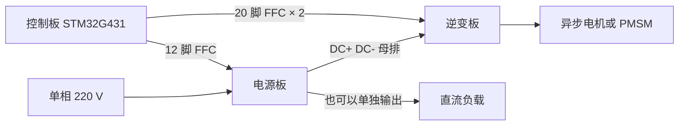

# 实验链路与板卡架构

更新：2026-11-05。采用 **变频板与电源板，每块板一颗 STM32G431**；每块板把本板控制、采样保护、驱动和功率级合在同一 PCB。取消共用独立控制板，以及一颗 MCU 同时控制两套逆变与 PFC 的要求。当前架构与未定项见 [合板方案](../../docs/integrated_board.md)，长期模块方向见 [路线规划](../../docs/roadmap.md)。

## 当前两类板卡

| 板卡 | 本板职责 | 当前边界 |
| --- | --- | --- |
| 变频板 | 本板 MCU 控制一套三相桥与一路制动，完成采样、模式控制和故障管理；驱动及独立硬件保护同板 | 沿用 12～60 V 母线、直流输入最大 10 A 等已定目标；完整型号、接口、新引脚和应用电路待重画 |
| 电源板 | 本板 MCU 控制本板电源功率级，完成采样与保护；Boost/Vienna 分两个版本研究 | 当前恢复讨论 PFC 加 LLC；指标、LLC 半/全桥、工作频率、资源和隔离/通信尚未冻结 |

PFC 加 LLC 若采用，目标仍是该电源板一颗 MCU；STM32G431 能否满足所选两级功率级的定时器、采样、保护和控制负载须重新评估，尚未作出可行性保证。两类板可分别调试，不要求另一块板上的 MCU 为本板提供原始 PWM 或闭环采样。

## 低压实验链路

第一阶段不接市电，变频板可直接用实验直流源供母线，辅助电源另接 12～24 V 适配器。长期可组合下面的实验链路，但各级电压和功率必须重新匹配：

图中 LLC 若采用，与所属 PFC 按同一电源板单 MCU 方案评估；图示不代表级联能力已经实现。Boost 和 Vienna 为不同 PFC 版本，不相互串联。交流源与电机控制可以分别由两块变频板承担。

- 12~100 V 是早期实验电源范围设想，当前变频板仍以已确定的 12～60 V 为设计边界。电源板输入输出指标未定，不直接套用变频板或后续市电版参数。
- 栅极驱动与功率母线仍分开考虑。合板后重新核对辅助供电容量、模拟参考、回流、供电默认态及驱动 UVLO。
- PWM、ENABLE、FAULT、BRAKE 及本地采样改为板内连接，不再由共用 controller 经 FFC 控制。
- 板间需要的给定、运行状态、联锁和故障协调应单独定义；通信方式、连接器、隔离和接地边界尚未选定。
- MCU 完整后缀、编码器/SPI 等接口数量及两类板的固件资源分别核对。原 controller 引脚表与旧 ERC 不能代替合板审核。

## 历史市电分板方案

以下保留上一版单相 220 V 技术讨论，供以后重新评估。**其中三块独立 PCB、共用控制板、20/12 脚 FFC、TIM1/TIM8 分工、辅助供电分配和机械堆叠均已被当前合板架构取代；下方描述不作为新版接线或采购要求。** 390 V/350～410 V 母线、420 V 过压、650 V 器件与 1～2 kW 也只是该历史市电方案的候选参数，不是当前低压变频板或新电源板已定指标。

三块电路板各自独立，用螺钉柱固定，信号用扁平排线插接。输入是单相 220 V。同一套逆变功率板驱动异步电机和永磁同步电机，差别在控制板软件。

这是 400 V 母线的产品结构。以前讨论的 100 V、0~60 V 实验逆变是另一块功率板，不能直接接到这套母线上。

### 三块板

| 板 | 职责 | 不做什么 |
|----|------|----------|
| 电源板 | 智能直流电源：PFC、母线稳压、限流、预充、辅助电源、硬件保护 | 不驱动电机 |
| 逆变板 | 三相桥、栅极驱动、采样、硬件过流、制动斩波 | 不接电网 |
| 控制板 | 电压电流给定、PWM、采样、故障、板卡识别 | 不接触母线和栅极 |

电源板可以不接逆变板，单独当高压直流电源用。接上逆变板时，母线仍由控制板给定，默认约 390 V，可在大约 350~410 V 内改。

智能功能在控制板上：设定电压、设定限流、读输入输出和温度、记录故障。电源板只做功率级、采样和硬件保护，自己不跑控制算法。

| 模式 | 谁插着 | 输出 |
|------|--------|------|
| 变频器前级 | 电源板 + 逆变板 + 控制板 | 母线约 390 V，再变成三相交流 |
| 独立电源 | 电源板 + 控制板 | 可编程直流，恒压或恒流 |

### 母线

单相 220 V 经升压 PFC 后，直流母线约 **390 V**，过压按约 **420 V** 留。开关器件按 **650 V** 等级选，不能用 200 V 的 MOSFET。

第一台按大约 1~2 kW 做接口。电机额定电压定下来之后，再核算母线电流和线径。

电源板出三路电，分三个接口，不塞进 FFC。

| 路 | 电压 | 能否调节 | 送给谁 | 参考地 | 接口 |
|----|------|----------|--------|--------|------|
| 母线 | 约 350~410 V | 能。恒压或恒流，由控制板给定 | 逆变板，或单独接直流负载 | DC− | 螺钉端子和短母排 |
| 栅极驱动 | +15 V，固定 | 不调 | 只给逆变板 | 功率地，与 DC− 相同 | 单独 2 芯，不进信号排线 |
| 低压 | 隔离 +12 V，固定 | 不调。控制板再稳到 3.3 V | 只给控制板 | 控制地，与母线隔离 | 单独 2 芯，不进 FFC |

母线是升压 PFC。单相 220 V 的峰值大约 310 V，输出必须高于这个峰值才能稳住，所以下限大约 350 V，上限按 420 V 过压和 650 V 器件留到大约 410 V。再低就要在升压后面加降压，那是另一级功率电路。

+15 V 低了功率管开不足，高了会超过栅极耐压。+12 V 只给控制板做 3.3 V，没有必要跟着母线给定变。这两路用辅助电源的固定绕组。

控制板用已有的母线电压采样做电压环，用电感电流做限流。TIM8 的 PWM 仍然走 12 脚 FFC 的第 1 脚。逆变板不插时，只调母线，15 V 空着。

辅助电源从整流后的市电取电，所以 PFC 还没启动时，低压和 +15 V 已经有了。控制板先起来，再允许升压。逆变板不插时，+15 V 空着，母线和低压照常工作。

栅极驱动的电流按六只功率管、约 20 kHz 留，第一台按 1 A 做这路接口。低压按控制板 12 V、0.5 A 留。母线电流等电机功率定了再算。

### 接口建议

信号已经在功率板上变成 3.3 V，线固定在机箱里，用 **0.5 mm FFC**。它比 20 脚 XH 短、扁，左右两根线的脚数不同，插不反。

| 连接 | 接插件 | 立创 |
|------|--------|------|
| 控制板 ↔ 逆变板 | 两根 20 脚 FFC。左线 PWM，右线采样 | 座 `AFC01-S20FCA-00`，C262667 |
| 控制板 ↔ 电源板 | 一根 12 脚 FFC，只有信号 | 座 `AFC01-S12FCA-00`，C262661 |
| 母线 | DC+、DC− 螺钉端子加短母排，带绝缘护罩 | 按母线电流选型 |
| +15 V 栅极电源 | 2 芯，从电源板到逆变板 | 与信号座分开 |
| 隔离 12 V | 2 芯，从电源板到控制板 | 与 FFC 分开 |

20 脚座：<https://www.szlcsc.com/product-detail/C262667.html>

12 脚座：<https://www.szlcsc.com/product-detail/C262661.html>

脚位沿用控制板已有的左右定义，见 [../../controller/docs/connector.md](../../controller/docs/connector.md)。左线 L1~L20，右线 R1~R20。电源板只用 12 脚：

| 脚 | 信号 |
|----|------|
| 1 | PWM，升压管 |
| 2 | GND |
| 3 | ENABLE |
| 4 | FAULT_N |
| 5 | 电感电流 |
| 6 | AGND |
| 7 | 交流电压 |
| 8 | AGND |
| 9 | 母线电压 |
| 10 | TEMP |
| 11 | 预充继电器 |
| 12 | GND |

栅极驱动焊在逆变板上，紧挨功率管。FFC 上只有已经隔离到控制地的 3.3 V 信号。隔离器件放在两块功率板上，控制板本身不带高压。

经常拔插、或振动很大时，再把 FFC 换成 JST GH 小卡扣座。GH 常见是 10 脚，40 个信号要拆成多只座。第一台机箱内固定，优先 FFC。

### 机械堆叠

自下而上：

1. 散热器。逆变桥和 PFC 的功率器件都贴在这一块上。
2. 逆变板、电源板并排用螺丝固定到散热器。高压端子朝外侧，FFC 座朝控制板。
3. M3 螺钉柱，高度约 12~15 mm。
4. 控制板悬在螺钉柱上，不压到母排和功率端子。

螺钉柱承受重量和振动。排线悬空长度放在同一机箱内，不超过约 15 cm，并用线夹固定。带电不拔 FFC，也不拆母排。

### 控制板

STM32G431RBT6。TIM1 出逆变的六路互补 PWM，TIM8 出电源板的升压 PWM。两路 ADC 分别读逆变采样和电源采样。恒压、恒流在控制板里完成。板卡识别仍用来区分以后换上去的其他功率板。

这块板留两只 20 脚 FFC 座和一只 12 脚 FFC 座。多出来的 20 脚座给第二路电机预留，第一台可以不贴。
